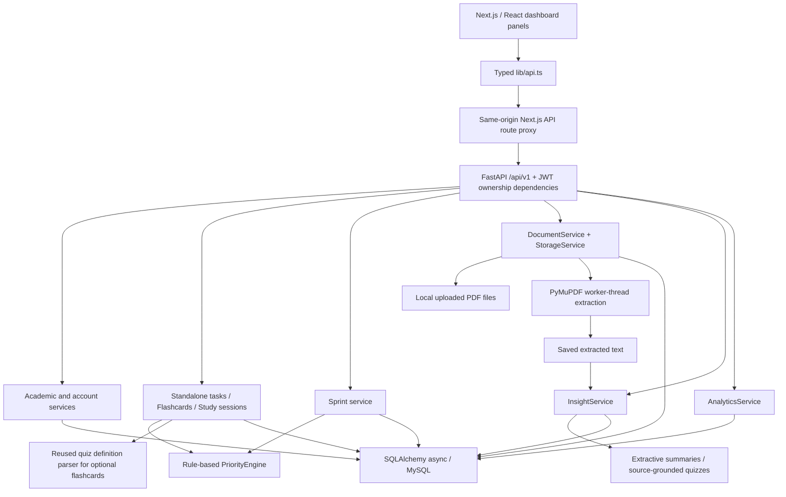

# StudyFlow architecture

Updated 2026-10-18. Implemented modules are described here; historical phase reports
are not current test certificates. See [audit](../AUDIT_REPORT.md) and
[enhancement report](enhancement-report.md).

## Modules and data flow

Standalone diagram: [architecture-diagram.mmd](architecture-diagram.mmd).
Services connect directly to the database; requests do **not** all flow through the
priority engine, nor does the database feed the file store sequentially.

## Actual stack and entry points

- **Web:** Next.js 15 App Router, React 19, TypeScript, Tailwind CSS and Lucide.
  `apps/web/app/layout.tsx` wraps landing, login and dashboard pages. Dashboard
  client panels implement existing academic tools, Notes/PDFs, Sprint, Tasks,
  Flashcards, Study Timer and Analytics. No additional chart runtime dependency.
- **Transport:** `apps/web/lib/api.ts` calls relative `/api/v1` by default.
  `app/api/v1/[...path]/route.ts` forwards requests using server-side `API_PROXY_TARGET`.
  `next.config.ts` configures standalone output and a `/health` rewrite.
- **API:** `apps/api/app/main.py`, `api/routes/`, `schemas/`, `services/`, `models/`.
  FastAPI/Pydantic v2; SQLAlchemy async sessions via `db/session.py`.
- **Database:** MySQL target (`mysql+aiomysql`, existing async drivers retained).
  SQLite is a test/development substitute, **not** a claim of MySQL verification.
- **Storage:** local `UPLOAD_DIR`, filenames under a user-specific directory;
  database stores metadata/text, not the PDF binary. Back up database and uploads together.

## Data model: 18 tables

| Tables | Relationships and responsibility |
|---|---|
| `users` | Account/profile, password hash, active flag. Owns student records. |
| `semesters` → `subjects` → `topics` | Academic hierarchy; user FKs and cascading academic children. Topics store status, importance, estimated/completed hours. |
| `exams` | Owner, subject, optional semester, date/status/marks; related Sprint history cascades when its exam is explicitly deleted. |
| `notes` | Owner, optional subject/topic (`SET NULL`), text, tags, pin state. |
| `documents` | Owner, optional subject/semester, stored filename, unique `(user_id, content_hash)`, extracted text/page offsets/status/errors. |
| `document_summaries` | Owner; source document or note; extractive result/version/history. Source deletion cascades. |
| `quizzes`, `quiz_questions` | Owner/source/context and grounded questions/options/answers/excerpts. |
| `quiz_attempts`, `quiz_attempt_answers` | Owner, grading results, selected answers, submitted time, optional supplied quiz duration. |
| `sprints`, `sprint_days`, `sprint_tasks` | Unique owner/exam Sprint, unique Sprint/date day, unique day/task-key generated tasks. Completed work survives recalculation. |
| `study_tasks` | Independent planner; optional subject/topic/exam (`SET NULL`), title/description/date/estimate/priority/status/completed timestamp. Per-owner content fingerprint rejects identical tasks. No Sprint FK. |
| `flashcards` | Owner, subject/topic (`SET NULL` on deletion), front/back, known/revision state, review timestamp. Optional generation provenance is snapshot metadata (`source_type`, `source_id`), not a polymorphic foreign key. Cards survive source removal. |
| `study_sessions` | Owner, subject/topic (`SET NULL`), lifecycle timestamps, accumulated and final seconds, nullable open-session slot, optimistic version. Unique `(user_id, active_slot)` allows one active/paused session and many terminal sessions with NULL slots. |

A subject is required when creating a card or starting a session. Nullable stored
references preserve existing cards/history if academic context is deleted.
Run API and database clocks in UTC for timestamp defaults. New responses transmit explicit
UTC offsets so browsers display session times correctly.
New routes validate referenced ownership and subject/topic/exam consistency on writes.
Protected lookups of another student's row return 404. List/analytics queries are owner-scoped.

## Authentication and authorization

The browser stores the access token in localStorage (existing mechanism retained).
The same-origin client uses `X-StudyFlow-Token`; Next.js translates it to Bearer for
FastAPI. Direct-API deployments use Bearer and require configured CORS.
`get_current_user` verifies signed JWT, issuer, expiry, active account and a keyed
signature tied to the current password hash. New passwords use Argon2id; legacy
bcrypt hashes upgrade at login. Password change returns a fresh token and invalidates
older sessions. Tokens are not stored as database rows. This enhancement does not
introduce cookies, refresh-token storage or a new authentication protocol.

## Study logic

- **Priority:** incomplete topic = importance × 10 + urgency (≤2 days +50, ≤7 +30,
  ≤14 +15), completed = 0. General tasks reuse this function with High/Medium/Low
  mapped to 5/3/1 and due date as urgency input; terminal tasks score zero. The UI
  exposes the score and explanation. Task priorities do not mutate Sprint scheduling.
- **Sprint:** explicit exam selection, timezone and daily budget; current day generated
  lazily. Uses incomplete-topic scores, priority boosts and recent quiz revision signals.
  Recalculation keeps completed rows and matching pending IDs; no general-task coupling.
- **Flashcards:** manual CRUD and simple review; optional generation reuses
  `quiz_engine.collect_candidates`, not a model or external AI service. Generated
  cards are labeled and repeated source/front generation reuses saved cards.
- **Timer:** manual start; UTC timestamps and integer seconds stored server-side.
  Pausing accumulates only the active segment; resuming resets its start timestamp;
  finishing persists final duration. Paused intervals never count. Active timers
  continue while the page is closed; the UI explicitly explains this and recovers the
  open session through `/study-sessions/active`. Finish or cancel before another start.
  Only **completed** sessions contribute to recorded-time analytics. Locks, unique
  slots and row versions protect starts/transitions across tabs; conflicts return 409.
- **Analytics:** saved topic completion/subject progress, latest 30 quiz attempts
  (all saved attempts used for average/best), upcoming exams with Upcoming status and
  date ≥ server today, exams explicitly Completed, estimated topic hours versus completed
  timer time, independent task counts and known/revision card counts. Cancelled and
  past-but-uncompleted exams are not mislabeled completed. Empty values are 0 or null.
  `completed_hours` on topics is manual/estimate-derived and is not timer time.

Quiz scores, self-reported known cards and task completion are **not proof of mastery**.
No trained prediction model, GPT/BERT/RAG, vector DB or external private-document API.

## PDF and insights pipeline

Upload → extension/MIME/header/size validation → per-user SHA256 duplicate check → local
file + document record → PyMuPDF via `asyncio.to_thread` → saved text/page offsets or
**failed** status with code/message. Summaries score source sentences using TF-IDF-style
chunk/position heuristics; quiz generation selects definitions or quoted factual passages and same-source
distractors and quotes evidence. Answers stay hidden until grading. Regeneration preserves
summary history; extraction/insight failures never fabricate success.

Scanned/image-only or blank files have actionable errors. **OCR is not implemented**;
use a local open-source tool such as OCRmyPDF/Tesseract to add a text layer and upload
the converted file. Retry reads the stored original, not a replacement from the computer.
Mixed PDFs can contain image-only pages the extractor cannot understand; text extraction
success is not certification that every page was readable. No OCR network calls occur.

## Configuration, schema and deployment

See `.env.example`, README run commands and `docker-compose.yml`.
`Settings` loads the root `.env`: `DATABASE_URL`, required strong `JWT_SECRET_KEY`,
`JWT_ALGORITHM`, `JWT_ISSUER`, `ACCESS_TOKEN_EXPIRE_MINUTES`, `CORS_ORIGINS`,
`UPLOAD_DIR`, `MAX_UPLOAD_SIZE_MB`. `API_PROXY_TARGET` is a **Next.js server** variable;
`NEXT_PUBLIC_API_URL` overrides browser requests and should normally remain unset.
Compose's `MYSQL_*` variables initialize the MySQL container; configure `DATABASE_URL`
with host `db` inside Compose, `localhost` for a local API.

Setup SQL is mirrored in root and `apps/api`. Additive migrations 005–008 create tables
without resetting existing rows. `metadata.create_all` also creates missing tables at
startup; it does **not** alter existing tables or repair schema drift. Back up first;
apply numbered SQL explicitly to existing MySQL installations. There is no Alembic runner.
The migrations' live MySQL execution remains unverified in this environment.

Deploy web/API on 0.0.0.0, use same-origin proxy, persistent MySQL storage and persistent
uploads. Compose already persists MySQL; its existing API service does **not** mount
persistent uploads, so add a volume before treating container replacement as durable PDF
storage. Use HTTPS, a unique secret, backups and explicit CORS in a real deployment.

## Deferred work

Local OCR integration, spaced repetition, notifications/calendar sync, predictive learning
models, automatic topic mastery diagnosis and large-scale reporting optimization. None is
required to use the implemented lightweight organizer.
